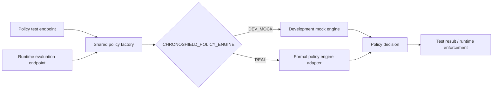

<p align="center">
  
</p>

<p align="center">
  <a href="#-the-idea"></a>
  <a href="#-how-a-request-is-decided"></a>
  <a href="#-current-scope--honest-status"></a>
  <a href="#-team-invox"></a>
</p>

<h3 align="center">Test before runtime. Enforce before execution.</h3>

<p align="center">
  ChronoShield is a policy-driven API security layer for smart-city services and AI-agent requests.<br />
  It evaluates <b>who is asking, what they want to do, and which resource they are targeting</b> before a supported operation is allowed to proceed.
</p>

<p align="center">
  <a href="#-quick-start">Quick start</a> ·
  <a href="#-architecture">Architecture</a> ·
  <a href="#-api-reference">API reference</a> ·
  <a href="#-security-scenarios">Security scenarios</a> ·
  <a href="#-roadmap">Roadmap</a>
</p>

---

<p align="center">
  
  
</p>

<p align="center"><sub>Request → resolve trusted context → evaluate policy → enforce before supported execution</sub></p>

---

## 🧭 Table of contents

- [The idea](#-the-idea)
- [The security problem](#-the-security-problem)
- [How a request is decided](#-how-a-request-is-decided)
- [Architecture](#-architecture)
- [Decision model](#-decision-model)
- [Security scenarios](#-security-scenarios)
- [Features and implementation boundaries](#-features-and-implementation-boundaries)
- [API reference](#-api-reference)
- [Quick start](#-quick-start)
- [Project structure](#-project-structure)
- [Testing and verification](#-testing-and-verification)
- [Security design principles](#-security-design-principles)
- [Limitations](#-limitations)
- [Roadmap](#-roadmap)
- [Team INVOX](#-team-invox)
- [References](#-references)

---

## 💡 The idea

Smart-city platforms expose APIs for parking, traffic management, water infrastructure, sensors, and other civic services. Users and AI agents may need to call these APIs automatically, but a valid identity should **not** imply unrestricted access.

ChronoShield inserts an explicit policy decision between a requester and the protected service. The backend evaluates the requested action against trusted identity information, the operation, and the target resource's server-side metadata. It then returns a structured decision and enforces it before a supported service operation runs.

> **The core question:** Is this requester authorized to perform this specific action on this specific resource under the applicable policy?

### Why this matters

| Without resource-aware enforcement | With ChronoShield |
|---|---|
| A valid token can be mistaken for broad permission. | Identity is evaluated alongside role, operation, and target resource. |
| Client-supplied resource metadata may be misleading. | The backend resolves actual resource ownership from server-side data. |
| Policy checks can drift between test and runtime paths. | Policy testing and runtime use the same engine-selection mechanism. |
| A generic denial gives little debugging context. | Structured outcomes and reason codes explain the decision. |

## 🧱 The security problem

Imagine a city split into North and South districts. A North District operator has legitimate access to North District parking, but tries to read a South District record:

```text
Caller:       North District operator
Credential:   valid demo token
Request:      GET /parking/park_south_1
Actual owner: South District
Expected:     DENY · DISTRICT_MISMATCH
Execution:    not attempted
```

Authentication may establish who the caller is. It does not, by itself, establish that the caller may access the resource or invoke the requested operation.

ChronoShield's current MVP demonstrates this problem with synthetic parking data. The same design is intended to support user-initiated and AI-agent-initiated API requests, while additional service adapters and production identity integration remain future work.

## 🔄 How a request is decided

<p align="center">
  
</p>

1. **Receive** — a client or AI agent sends an operation and target resource.
2. **Validate** — the FastAPI gateway validates the request shape and supported action.
3. **Resolve identity** — the backend maps a trusted demo token to the associated identity. Body fields supplied by the client are not treated as proof of identity.
4. **Resolve resource** — the gateway obtains the target resource's actual metadata from server-side data. A client-supplied district is not authoritative.
5. **Evaluate policy** — the configured policy engine checks the identity, role, operation, resource ownership, and applicable rules.
6. **Enforce** — the gateway permits supported execution only for an `ALLOW` decision. `DENY` and `APPROVAL_REQUIRED` do not execute the protected operation in the current MVP.
7. **Explain** — a structured response communicates the decision, reason, and execution status.

### Test and runtime share policy-engine selection



The shared factory reduces the chance that policy-testing and runtime paths silently use different engine-selection logic. Invalid engine configuration is expected to fail loudly rather than silently fall back.

## 🏛️ Architecture

### Backend responsibilities

| Component | Responsibility |
|---|---|
| FastAPI gateway | Receives requests, validates input, coordinates evaluation, and enforces the decision. |
| Trusted identity resolution | Resolves the requester from the demo token carried in the request header. |
| Resource resolution | Uses server-side resource data to determine actual ownership and metadata. |
| `FormalPolicyEngine` / adapter | Evaluates formal authorization rules through the selected engine. |
| `DevMockPolicyEngine` | Provides the development mock engine mode. |
| Policy factory | Selects the engine based on `CHRONOSHIELD_POLICY_ENGINE`. |
| Parking executor | Demonstrates supported runtime operations against synthetic parking resources. |
| Policy testing route | Evaluates predefined cases without executing service operations or mutating parking state. |

### Frontend responsibilities

The React + TypeScript frontend includes a landing site and a security console. It talks to the FastAPI gateway; **the frontend does not decide whether a request should be allowed or denied**. Decisions displayed in the console are normalized from backend responses, not fabricated locally.

The console currently includes:

- **Overview** — gateway status and high-level project information.
- **Policy testing** — runs six predefined scenarios through the backend.
- **Request tester** — submits a request and renders the returned verdict.
- **Audit viewer** — displays browser-session events; it is not a server-authoritative audit-history viewer.
- **Approvals** — read-only placeholder; a complete approval queue and API workflow are not wired in.

## 🚦 Decision model

<p align="center">
  
</p>

| Decision | Meaning | Current execution behavior |
|---|---|---|
| `allow` | The policy permits the request. | A supported executor may run. Execution can still fail independently. |
| `deny` | The policy rejects the request. | The protected operation is not executed. |
| `approval_required` | A policy identifies a sensitive operation requiring approval. | Not executed. The full approval queue and workflow are not yet integrated. |

**Authorization and execution are separate results.** `allow` does not guarantee success, and `approval_required` does not mean the operation has been approved.

## 🧪 Security scenarios

The policy-testing endpoint evaluates six predefined scenarios. These are designed to demonstrate expected policy outcomes, not to claim that ChronoShield has been deployed against real city infrastructure.

| # | Scenario | Expected result | Why it matters |
|---:|---|---|---|
| 1 | North operator reads `park_north_1` | `allow` | Valid access within the operator's district. |
| 2 | North operator targets `park_south_1` | `deny` · `DISTRICT_MISMATCH` | A caller cannot cross the resource-ownership boundary. |
| 3 | Viewer attempts `reserve_spot` | `deny` · `ROLE_NOT_AUTHORIZED` | Roles restrict which operations can be performed. |
| 4 | Requester attempts `close_zone` | `approval_required` · `HIGH_IMPACT_APPROVAL_REQUIRED` | A high-impact operation is not executed immediately. |
| 5 | Unknown domain | Structured error · `UNKNOWN_DOMAIN` | Unsupported domains are rejected explicitly. |
| 6 | Unknown operation | Structured error · `UNKNOWN_OPERATION` | Unsupported operations are rejected explicitly. |

For unknown domains and operations, the API returns a structured validation error rather than a normal authorization verdict. The policy-test endpoint does not execute the protected service or mutate the parking state.

### Synthetic parking resources

| Resource ID | District | Capacity |
|---|---|---:|
| `park_north_1` | North | 120 spots |
| `park_north_2` | North | 200 spots |
| `park_south_1` | South | 150 spots |
| `park_south_2` | South | 80 spots |

These are synthetic demo resources, not live smart-city records.

## ✨ Features and implementation boundaries

| Capability | Status | Notes |
|---|---|---|
| FastAPI runtime evaluation endpoint | Implemented in MVP | `POST /api/v1/requests/evaluate` |
| Policy scenario testing | Implemented in MVP | Six predefined cases at `POST /api/v1/policies/test` |
| Shared policy-engine factory | Implemented | Used by policy tests and runtime evaluation. |
| `DEV_MOCK` and `REAL` engine modes | Implemented | Selected through environment configuration. |
| District isolation and role restrictions | Demonstrated with synthetic parking data | Backend-side resource metadata is authoritative. |
| Parking mock executor | Implemented | Other registered domains do not yet have full runtime executors. |
| React landing site and security console | Implemented | Uses the backend gateway for decisions. |
| Complete approval workflow | Not yet integrated | `approval_required` is returned, but there is no complete approval queue and execution-after-approval workflow. |
| Durable backend audit history API | Not yet integrated | The frontend audit viewer shows browser-session events, not authoritative remote audit history. |
| Production JWT/OIDC identity | Planned | Current identity uses demo tokens. |
| Traffic and water runtime adapters | Planned | Each additional domain needs a resource model, tests, and a verified executor. |
| Production monitoring, rate limiting, and hardening | Planned | Required before production use. |

## 🔌 API reference

The backend exposes the following relevant routes:

| Method | Endpoint | Purpose |
|---|---|---|
| `GET` | `/api/v1/health` | Health check. |
| `GET` | `/openapi.json` | OpenAPI schema used by the frontend to discover the API contract. |
| `POST` | `/api/v1/policies/test` | Evaluates six predefined policy scenarios without executing services. |
| `POST` | `/api/v1/requests/evaluate` | Evaluates a request and enforces the result for supported operations. |

### Example: cross-district request

The following is an **illustrative request shape** for the demo API. Use the live `/openapi.json` schema as the authority if the request model changes.

```http
POST /api/v1/requests/evaluate HTTP/1.1
Host: 127.0.0.1:8000
Content-Type: application/json
x-auth-token: token_operator_north
```

```json
{
  "request_id": "demo-cross-district-001",
  "action": {
    "request_id": "demo-cross-district-001",
    "domain": "parking",
    "operation": "read",
    "resource_id": "park_south_1",
    "resource_district_id": "district_north"
  },
  "actor": {
    "user_id": "user_operator_north",
    "role": "operator",
    "district_id": "district_north"
  }
}
```

In this example, the body claims the target is in the North District even though `park_south_1` belongs to the South District. The **server-side resource record is authoritative**; client-provided actor and district fields are not trusted as proof of identity or ownership.

A representative decision excerpt looks like this (the full response may include additional fields):

```json
{
  "decision": "deny",
  "reason_code": "DISTRICT_MISMATCH",
  "message": "Identity district 'district_north' does not match resource district 'district_south'",
  "executed": false
}
```

### Run the predefined policy tests

```bash
curl -X POST http://127.0.0.1:8000/api/v1/policies/test \
  -H "Content-Type: application/json" \
  -d '{}'
```

### Check gateway health

```bash
curl http://127.0.0.1:8000/api/v1/health
```

### Demo-token note

Tokens such as `token_operator_north` and `token_viewer` are for local demonstration only. They are not production credentials. The backend maps `x-auth-token` to a trusted identity; the request-body `actor` object is an unverified hint and must not replace the server's identity resolution.

## 🚀 Quick start

This repository contains both the FastAPI backend and the React + TypeScript frontend. Start the backend first, then start the frontend in a second terminal from the repository root.

### 1. Start the backend

Run these commands from the repository root, where `app/main.py` and `requirements.txt` are present.

**Windows PowerShell:**

```powershell
# Create and activate a virtual environment (recommended).
py -m venv .venv
.\.venv\Scripts\Activate.ps1

# Install backend dependencies.
python -m pip install --upgrade pip
pip install -r requirements.txt

# Start the mock policy engine.
$env:CHRONOSHIELD_POLICY_ENGINE = "DEV_MOCK"
uvicorn app.main:app --reload --port 8000
```

To use the formal engine adapter instead, stop the server and run in the same activated environment:

```powershell
$env:CHRONOSHIELD_POLICY_ENGINE = "REAL"
uvicorn app.main:app --reload --port 8000
```

### 2. Start the frontend

Open a second terminal at the repository root (the folder containing `package.json`):

```bash
npm install
```

Create a local environment file from the example. On macOS/Linux:

```bash
cp .env.example .env
```

On Windows PowerShell:

```powershell
Copy-Item .env.example .env
```

Start the Vite development server:

```bash
npm run dev
```

The frontend should be available at `http://localhost:5173`. The console is available at `/console`.

### 3. Frontend environment settings

The included `.env.example` uses the Vite proxy so local browser requests route to the backend without requiring a local CORS change:

```dotenv
VITE_API_BASE_URL=/backend
VITE_PROXY_TARGET=http://127.0.0.1:8000
VITE_SPLINE_SCENE=
```

`VITE_SPLINE_SCENE` is optional. The native WebGL hero animation can run without the external Spline scene.

For a deployed frontend, set `VITE_API_BASE_URL` to the gateway URL and configure the backend's allowed origins appropriately.

### 4. Useful development commands

Run from the repository root (the folder containing `package.json`):

```bash
npm run typecheck
npm run lint
npm run build
npm run preview
```

Optional: generate TypeScript API types from a running local backend:

```bash
npm run gen:api
```

The frontend also reads the OpenAPI schema at runtime, so its forms and endpoint registry can adapt to the live API contract.

## 🗂️ Project structure

The backend and frontend live together in this repository. The layout below reflects the current `main` branch.

### Repository layout

```text
ChronoShield/
├── app/
│   ├── main.py                     # FastAPI application entry point
│   ├── api/                        # Gateway and policy-test routes
│   ├── schemas/                    # API request/response models
│   ├── security/                   # Formal engine, policies, approval/workflow logic
│   └── services/                   # Gateway, identity, parking, policy adapter/factory
├── src/                            # React + TypeScript application
│   ├── landing/                    # Project story and live demo
│   ├── console/                    # Overview, policy testing, request tester, audit, approvals
│   ├── components/                 # Schema-driven form and verdict components
│   └── styles/                     # Base, component, landing, and console styles
├── tests/                          # Backend test suite
├── public/                         # Static frontend assets
├── assets/                         # README SVG graphics included in this package
├── requirements.txt                # Python dependencies
├── package.json                    # Frontend scripts and dependencies
├── .env.example                    # Frontend environment template
├── vite.config.ts                  # Vite and /backend proxy configuration
└── README.md
```

The layout above reflects the `main` branch at the time this README was reviewed; supporting files are omitted for readability.

## ✅ Testing and verification

The repository documentation records a previous full-stack verification run with the following results. **These are historical results, not a guarantee about the current commit. Re-run these checks before submission or deployment.**

| Check | Recorded result | Notes |
|---|---|---|
| Backend tests — `DEV_MOCK` | `318 passed / 318 collected` | One non-blocking FastAPI/httpx deprecation warning. |
| Backend tests — `REAL` | `318 passed / 318 collected` | Run in an isolated process with `REAL` selected. |
| Frontend type-check | Passed | `npm run typecheck` |
| Frontend lint | Passed | No errors; report noted informational React compiler / Fast Refresh notices. |
| Frontend production build | Passed | `npm run build` |
| Policy-test endpoint | 6 of 6 predefined cases passed | Recorded local integration verification. |
| Vite proxy to backend | Passed | `/backend` proxy forwarded to `127.0.0.1:8000`. |

### Suggested verification sequence

Run backend test modes in separate processes to avoid environment/configuration state leaking between engine selections:

```powershell
$env:CHRONOSHIELD_POLICY_ENGINE = "DEV_MOCK"
python -m pytest -q
```

Then in a fresh shell/process:

```powershell
$env:CHRONOSHIELD_POLICY_ENGINE = "REAL"
python -m pytest -q
```

Run frontend checks from the frontend directory:

```bash
npm run typecheck
npm run lint
npm run build
```

Do not publish a passing test badge until a fresh run confirms the result on the current code.

## 🛡️ Security design principles

1. **Server-side ownership is authoritative.** Client-supplied district data cannot establish ownership of a protected resource.
2. **Identity and request-body claims are separated.** The backend resolves trusted identity from the demo token rather than trusting `actor` fields as proof.
3. **Policy evaluation precedes supported execution.** Denied and approval-required requests do not execute the protected operation in the current MVP.
4. **Default-deny / fail-closed intent.** Unknown or malformed policy-engine output must not be treated as permission to execute.
5. **Reasons are explicit.** Codes such as `DISTRICT_MISMATCH`, `ROLE_NOT_AUTHORIZED`, `UNKNOWN_DOMAIN`, and `UNKNOWN_OPERATION` make decisions easier to inspect.
6. **No false verdicts in the frontend.** The UI reports backend results and structured errors rather than manufacturing authorization outcomes when the gateway is unavailable.
7. **Testing is separate from execution.** Policy tests do not call domain executors or mutate parking state.

## ⚠️ Current scope & honest status

ChronoShield is a working development MVP, not a production smart-city security product.

- **Identity:** demo tokens are used; production JWT/OIDC integration is not complete.
- **Execution:** the current mock executor supports parking. Traffic, water, and other registered domains need verified runtime adapters before they can execute real operations.
- **Approvals:** an `approval_required` decision is demonstrated, but a complete approval queue, API workflow, and safe execute-after-approval path are not integrated.
- **Auditing:** the frontend audit view contains browser-session events. A server-authoritative audit-history endpoint and durable audit storage are future work.
- **State:** synthetic parking state and current audit records are not a durable production data layer.
- **Operations:** monitoring, rate limiting, production identity, secrets management, and deployment hardening remain outstanding.
- **Testing:** historical results in this document describe a recorded verification run. Always re-run the suite against the current checkout before claiming the same result.

These limits are explicit by design: they make the MVP's security behavior demonstrable without overstating the amount of production integration that has been completed.

## 🗺️ Roadmap

<p align="center">
  
</p>

| Phase | Focus | Completion criteria |
|---|---|---|
| 1 · Harden core | Validate malformed results and edge cases | Tests pass in both engine modes; real request/response evidence is captured. |
| 2 · Production identity and audit | JWT/OIDC, durable events, server-side history | Identity is externally verifiable and audit history survives process restarts. |
| 3 · Approval workflow | Reviewer permissions, status tracking, post-approval execution | Pending actions cannot execute until an authorized approval is recorded. |
| 4 · Expand domains | Traffic and water resource models and adapters | Each domain has policy tests and a verified executor. |
| 5 · Operational hardening | Monitoring, rate limiting, secrets and deployment controls | Security and operations controls are documented and tested. |

## 👥 Team INVOX

| Member | Contribution / role |
|---|---|
| **Dilip S** | Team lead, as listed in the original project deck. |
| **Manish Jindal** | Team contributor; specific role to be confirmed. |
| **Sushanth Hegde** | Team contributor; specific role to be confirmed. |
| **Ashish P** | Backend and integration lead. |

## 📚 References

- [OWASP API Security Project](https://owasp.org/www-project-api-security/) — background on API authorization risks, including broken object-level and broken function-level authorization.
- FastAPI documentation: <https://fastapi.tiangolo.com/>
- Vite documentation: <https://vite.dev/>

---

<p align="center">
  <b>ChronoShield</b><br />
  <i>Authorization must travel with the resource.</i><br />
  Team INVOX · ChronoForge · Cybersecurity
</p>
